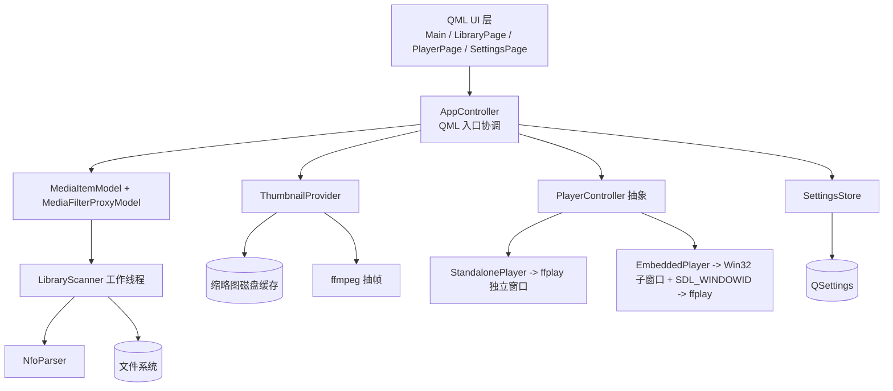

## Product Overview
一个 Windows 桌面端本地媒体库播放器（LkPlayer）。用户指定一个媒体库根目录，程序递归扫描其中的视频及其旁挂资源（海报、nfo、字幕、剧照），以现代化界面提供"全库平铺"与"逐层钻取"两种浏览方式，支持按标签过滤，并通过外部 ffmpeg/ffplay 完成播放（播放画面可内嵌到主窗口，也可使用独立窗口，由设置切换）。

## Core Features
- **媒体库根目录配置与递归扫描**：用户选择根目录，后台扫描其下所有子文件夹中的视频文件，目录层级如 `Root/Scene/Act1/PPC-001/PPC-001-title.mp4`。
- **旁挂资源自动关联**：按"同目录 + 同名/同前缀"规则关联视频旁边的海报、nfo、字幕（.srt/.ass 等）、剧照/背景图。
- **nfo 解析与标签**：解析 Kodi 风格 `.nfo`（标题、简介、年份、演员、标签等），提取标签供筛选使用。
- **双模式平铺浏览**：
  - 全库平铺：Root 下所有视频递归汇总为一个平铺网格；
  - 逐层钻取：以面包屑方式进入 Scene → Act1 → PPC-001，进入某层后平铺展示该层内容，并可继续下钻。
- **标签过滤**：侧边标签面板多选/筛选当前网格内容，实时生效。
- **缩略图/封面**：优先使用旁挂海报，无海报则调用用户指定的 ffmpeg 抽取一帧作为封面，结果做磁盘缓存，避免重复计算。
- **播放能力**：调用用户指定目录下的 ffplay 播放，支持播放/暂停、进度跳转、音量、静音、停止；支持"内嵌到 QML 窗口"与"独立播放窗口"两种模式切换（ffmpeg 用于抽帧与媒体信息探测）。
- **程序目录设置**：用户可在设置中指定 ffmpeg/ffplay 所在目录，程序校验可执行文件存在性并给出反馈。
- **视觉与交互**：深色现代影音风格界面，卡片式海报网格、悬停放大与渐变高亮、平滑过渡动画、自适应窗口布局；播放页含沉浸式视频区域与控制条。


## Tech Stack Selection
- **语言/标准**：C++17
- **UI 框架**：Qt 6.11.2（Qt Quick / QML），样式基座 `FluentWinUI3`（不可用时回退 `Fusion`/`Basic`）
- **构建**：CMake + Ninja（MSYS2 UCRT64，GCC 16.2.0）
- **Qt 模块**：Core、Gui、Qml、Quick、QuickControls2、QuickDialogs2、QuickLayouts、QuickEffects、Svg、Xml、Concurrent、Widgets（仅用于原生窗口/对话框辅助）
- **媒体引擎**：外部进程 `ffplay`（播放）与 `ffmpeg`（抽帧/探测），路径由用户在设置中指定（默认预填 `V:/DevEnv/msys2/ucrt64/bin`）
- **持久化**：`QSettings`（INI，存于 `QStandardPaths::AppConfigLocation`）；缩略图缓存存于 `AppCacheLocation/thumbnails`
- **测试**：Qt6::Test（针对 nfo 解析与扫描关联逻辑做单元测试）

> 关键约束：环境中无 `Qt6Multimedia`，因此**不得**使用 QMediaPlayer/VideoOutput，播放必须完全依赖外部 ffplay 进程。

## Implementation Approach
整体采用**分层架构**：Core（数据与服务）→ Model（QML 可绑定模型）→ UI（QML）。C++ 负责扫描、解析、缩略图、进程与原生窗口，QML 只负责展示与交互，二者通过 `QAbstractListModel` + 属性/信号解耦。

关键决策：
1. **扫描异步化**：`LibraryScanner` 运行在独立工作线程（`QThread` + worker 对象），分批 emit 结果，避免大目录阻塞 UI；扫描结果构建 `MediaItem` 扁平集合与 `FolderNode` 树，供两种浏览模式共用同一份数据。
2. **模型 + 代理分离**：`MediaItemModel`（全量，含来源文件夹）承载数据；`MediaFilterProxyModel` 负责"当前文件夹范围过滤 + 标签过滤 + 搜索"，QML 只绑定代理模型与角色，切换浏览层级/标签时仅重设过滤条件，避免重复扫描与重建。
3. **缩略图走 `QQuickImageProvider`**：自定义 URL 形如 `image://thumb/<base64url(路径)>`，Provider 内查磁盘缓存，未命中则排队调用 ffmpeg 抽帧（并发上限约 4）并写缓存，缺失海报时才抽帧。磁盘缓存 key 用路径+修改时间哈希，保证失效正确。
4. **播放抽象**：定义抽象接口 `PlayerController`，`StandalonePlayer`（QProcess 启动 ffplay，独立窗口）与 `EmbeddedPlayer`（创建 Win32 子窗口并将 `SDL_WINDOWID` 注入 ffplay 进程实现内嵌）为两个实现，`PlayerFactory` 依设置创建。UI 只依赖抽象接口，屏蔽差异，便于后续替换为自绘 ffmpeg 渲染。
5. **内嵌实现要点**：内嵌模式下 ffplay 以 `-noborder` 启动；由 Qt 侧在 `QQuickWindow` 上创建子 HWND，随 QML 中 `VideoSurface` 的几何变化（含 `devicePixelRatio`）同步位置与大小；QML 播放页需保证视频区域内不放会与原生子窗口冲突的浮层，或浮层在激活时临时隐藏子窗口。
6. **进程状态同步**：解析 ffplay 写入 stderr 的状态行（`   7.02 M-A: ...`）更新进度，解析频率做节流；控制命令（暂停 `p`、退出 `q`、seek、音量）通过写入子进程 stdin 完成；`finished/errorOccurred` 信号同步 UI 状态并清理子窗口。

### 性能与可靠性
- 扫描：单次遍历时间 O(N)（N 为文件/目录数），仅一次目录遍历，nfo 解析按需；大目录下 UI 保持流畅。
- 缩略图：磁盘缓存 + 有限并发，避免重复抽帧；网格滚动时按需触发，不预生成全库封面。
- 进程：ffplay 单实例，切换视频先终止旧进程再启动；异常退出与 ffmpeg 路径无效有明确错误提示，不崩溃。
- 数据保护：配置与缓存写入失败仅告警，不阻断主流程；不使用相对路径拼接，统一 `QDir/QFileInfo` 处理。

## Implementation Notes
- **复用官方便捷模块**：QML 工程使用 `qt_add_qml_module`（自动生成 qmldir/类型注册），C++ 类型用 `QML_ELEMENT` 注册，避免手工 qrc 维护。
- **回退策略**：启动时若 `FluentWinUI3` 风格不可用，回退到 `Fusion`，保证不因样式缺失启动失败。
- **路径与可执行文件解析**：统一由 `PathUtils` 负责 `ffplay.exe/ffmpeg.exe` 查找与存在性校验，默认预填 MSYS2 路径，用户可在设置覆盖。
- **日志**：使用 `QLoggingCategory`（如 `lk.scan`/`lk.player`/`lk.thumb`），不打印完整媒体库路径列表等大payload；播放/扫描错误仅记录关键信息。
- **爆破半径控制**：Core 与 Model 不依赖 UI 具体实现；播放器抽象确保新增播放后端不改动 QML；本期不实现的功能（如转码、在线源）不预留无用代码。
- **QML 与原生窗口边界**：内嵌视频层仅占矩形区域，控制条浮层在该区域外或通过显隐切换处理，避免被原生子窗口覆盖导致不可点击。

## Architecture Design



### 数据流
选择根目录 → `SettingsStore` 保存 → `LibraryScanner` 后台扫描并逐步 emit `MediaItem` → `MediaItemModel` 追加 → `MediaFilterProxyModel` 按当前文件夹/标签/搜索过滤 → QML 网格渲染（`ThumbnailProvider` 按需出图）→ 点击卡片 → `PlayerFactory` 依设置创建播放器播放。

## Directory Structure

```
LkPlayer/
├── CMakeLists.txt                     # [NEW] 顶层构建：C++17、find_package(Qt6 ...)、qt_add_qml_module、可执行目标、tests 子目录
├── .gitignore                         # [NEW] 忽略 build/、Qt 生成文件、缩略图缓存等
├── README.md                          # [NEW] 构建与运行说明（MSYS2 UCRT64 工具链、依赖的 ffmpeg/ffplay）
├── src/
│   ├── main.cpp                       # [NEW] 应用入口：QGuiApplication、设置 App 名称/组织、初始化日志、加载 QML 主窗口、注册样式回退
│   ├── app/
│   │   └── AppController.h/.cpp       # [NEW] 暴露给 QML 的门面：根目录设置/扫描进度、视图模式(flat/drill)、当前文件夹与面包屑、标签集合与选中标签、播放控制转发、设置读写
│   ├── core/
│   │   ├── MediaItem.h                # [NEW] 媒体项数据结构：filePath/fileName/title/posterPath/nfoPath/subtitles/stillImages/tags/folderPath/relativeFolder/duration
│   │   ├── FolderNode.h               # [NEW] 目录树节点：路径、显示名、是否含子目录、视频计数
│   │   ├── NfoParser.h/.cpp           # [NEW] QXmlStreamReader 解析 Kodi 风格 nfo，容错处理缺失/损坏字段，提取 title/plot/year/genre/tag/actor 与标签归一化
│   │   ├── LibraryScanner.h/.cpp      # [NEW] 工作线程内的递归扫描：发现视频扩展名、关联旁挂资源、按规则匹配海报/字幕/剧照、解析 nfo、产生 MediaItem 与 FolderNode，分批 emit 信号
│   │   └── PathUtils.h/.cpp           # [NEW] 路径与可执行文件工具：ffplay/ffmpeg 查找与校验、海报候选名匹配、缩略图缓存 key 计算、URL 编解码
│   ├── model/
│   │   ├── MediaItemModel.h/.cpp      # [NEW] QAbstractListModel，承载全部 MediaItem，定义 imagePath/title/tags 等 QML 角色，支持 reset/append 批量更新
│   │   ├── MediaFilterProxyModel.h/.cpp # [NEW] QSortFilterProxyModel：按 folderScope(全库/当前目录)、selectedTags、searchText 过滤；暴露可用标签集合
│   │   └── FolderListModel.h/.cpp     # [NEW] 钻取模式下当前目录的子文件夹列表模型（供导航栅格/列表）
│   ├── thumb/
│   │   ├── ThumbnailProvider.h/.cpp   # [NEW] QQuickImageProvider：解析 image://thumb/ 请求，命中缓存直接返回，未命中排队抽帧；后台线程执行 ffmpeg，完成后回主线程通知 QML 刷新
│   │   └── ThumbnailCache.h/.cpp      # [NEW] 磁盘缓存管理：基于 AppCacheLocation，key=路径+mtime 哈希，LRU/上限清理，失败容错
│   ├── player/
│   │   ├── PlayerController.h         # [NEW] 抽象接口：open/play/pause/toggle/stop/seek/setVolume/setMute/position/duration/state 与信号
│   │   ├── StandalonePlayer.h/.cpp    # [NEW] 独立窗口实现：QProcess 启动 ffplay，解析 stderr 状态行取进度，stdin 写控制键，监听进程结束同步状态
│   │   ├── EmbeddedPlayer.h/.cpp      # [NEW] 内嵌实现：Windows 下创建 QQuickWindow 子 HWND、设置 SDL_WINDOWID 启动 ffplay -noborder、随 VideoSurface 几何与 DPR 同步子窗口位置尺寸、显隐与清理
│   │   └── PlayerFactory.h/.cpp       # [NEW] 依据设置(embedded/standalone)与可用性创建对应 PlayerController 实例
│   └── settings/
│       └── SettingsStore.h/.cpp       # [NEW] QSettings 封装：媒体库根目录、ffmpeg/ffplay 目录(默认预填 MSYS2 路径)、播放模式、主题、视图模式等读写与信号
├── qml/
│   ├── Main.qml                       # [NEW] 应用主窗口：ApplicationWindow、StackView/页面切换、全局主题与调色板、FluentWinUI3 回退装配
│   ├── theme/
│   │   ├── Theme.qml                  # [NEW] 单例主题：颜色、圆角、间距、动画时长、字体级别
│   │   └── Palette.qml                # [NEW] 深浅配色定义（深色为主，见设计配色）
│   ├── components/
│   │   ├── TopBar.qml                 # [NEW] 顶部栏：标题/Logo、搜索框、视图模式切换(平铺/钻取)、设置入口、窗口控制
│   │   ├── Breadcrumb.qml             # [NEW] 钻取模式面包屑，支持点击回退到任意层级
│   │   ├── SideBar.qml                # [NEW] 侧栏：目录树/标签过滤面板容器，可折叠
│   │   ├── TagFilterPanel.qml         # [NEW] 标签多选过滤面板，联动 MediaFilterProxyModel
│   │   ├── MediaCard.qml              # [NEW] 视频卡片：封面(海报/抽帧)、标题、标签徽标、悬停放大与渐变高亮、播放按钮
│   │   ├── FolderCard.qml             # [NEW] 钻取模式下文件夹卡片，点击进入下一层
│   │   ├── PlayerControls.qml         # [NEW] 播放控制条：播放/暂停、进度、时间、音量、静音、内嵌/独立切换、停止
│   │   ├── VideoSurface.qml           # [NEW] 内嵌视频矩形占位，向 C++ 上报几何(供原生子窗口定位)，独立模式时显示占位状态
│   │   └── EmptyState.qml             # [NEW] 空状态/加载中/错误提示（如未设置目录、未找到 ffplay）
│   └── pages/
│       ├── LibraryPage.qml            # [NEW] 媒体库主页：TopBar + SideBar + 面包屑 + 卡片网格(全库平铺/逐层钻取)、滚动懒加载
│       ├── PlayerPage.qml             # [NEW] 播放页：视频区域(VideoSurface) + 元信息(nfo 简介/标签/演员) + 控制条 + 剧照缩略
│       └── SettingsPage.qml           # [NEW] 设置页：媒体库根目录选择、ffmpeg/ffplay 目录选择与校验、播放模式、主题、缓存清理
├── assets/
│   ├── appicon.png                    # [NEW] 应用图标（由 [skill:多模态内容生成] 生成，深色影音风格）
│   └── poster-placeholder.png         # [NEW] 无封面时的占位海报图（由 [skill:多模态内容生成] 生成）
└── tests/
    ├── CMakeLists.txt                 # [NEW] Qt6::Test 目标配置
    ├── tst_nfoparser.cpp              # [NEW] nfo 解析单元测试：正常/缺失字段/损坏 XML/多标签
    └── tst_scanner.cpp                # [NEW] 扫描与旁挂关联单元测试：临时目录构造层级与旁挂文件，验证关联与标签提取
```

## Key Code Structures

```cpp
// src/player/PlayerController.h —— 屏蔽"内嵌/独立"两种后端的统一契约
class PlayerController : public QObject {
    Q_OBJECT
public:
    enum class State { Idle, Loading, Playing, Paused, Stopped, Error };
    Q_ENUM(State)

    explicit PlayerController(QObject* parent = nullptr);
    virtual ~PlayerController() = default;

    virtual void open(const QString& filePath) = 0;   // 打开并从 0 开始播放
    virtual void play() = 0;
    virtual void pause() = 0;
    virtual void togglePause() = 0;
    virtual void stop() = 0;
    virtual void seek(double seconds) = 0;
    virtual void setVolume(int volume /*0-100*/) = 0;
    virtual void setMuted(bool muted) = 0;
    // 内嵌模式：设置视频区域在窗口内的像素矩形；独立模式可忽略
    virtual void setVideoRect(const QRect& pixelRect) = 0;

    virtual State state() const = 0;
    virtual double position() const = 0;
    virtual double duration() const = 0;

signals:
    void stateChanged(State state);
    void positionChanged(double seconds);
    void durationChanged(double seconds);
    void errorOccurred(const QString& message);
};
```

```cpp
// src/core/MediaItem.h —— 扫描产出的核心数据结构（QML 通过模型角色访问）
struct MediaItem {
    QString filePath;            // 视频绝对路径
    QString fileName;            // 文件名
    QString title;               // 标题（优先取 nfo，回退文件名）
    QString folderPath;          // 所在目录绝对路径
    QString relativeFolder;      // 相对媒体库根目录的路径（用于面包屑）
    QString posterPath;          // 关联到的海报
    QString nfoPath;             // 关联到的 nfo
    QStringList subtitles;       // 关联到的字幕
    QStringList stillImages;     // 关联到的剧照/背景图
    QStringList tags;            // 来自 nfo，用于标签过滤
    double duration = 0.0;       // 秒，未知为 0
};
```


## 设计风格
面向影音媒体库的深色沉浸式现代风格，参考 Jellyfin/Emby 的卡片网格 + 玻璃拟态细节。深色底 + 紫色渐变强调色，圆角卡片、柔和阴影、悬停放大与渐变遮罩，逐层钻取带平滑页面过渡动画。基于 Qt Quick Controls 2，样式基座使用 FluentWinUI3（不可用回退 Fusion）。

## 布局与页面规划
采用固定顶部栏 + 可折叠侧栏 + 主内容区的桌面三段式布局，适配窗口任意缩放（响应式列数）。核心页面三张：

### 1. LibraryPage（媒体库主页）
- **顶部栏 TopBar**：Logo/标题、居中搜索框、右侧视图模式切换（全库平铺/逐层钻取）与设置按钮，半透明玻璃背景。
- **侧栏 SideBar**：上方为目录树/文件夹导航，下方为标签过滤面板；可折叠以扩大内容区。
- **面包屑 Breadcrumb**：钻取模式显示 Root/Scene/Act1/PPC-001，各级可点击回退；平铺模式显示"全部视频"。
- **内容网格**：海报卡片自适应列数（封面 2:3），卡片悬停放大 1.03、显示渐变遮罩与播放按钮；钻取模式下先显示子文件夹卡片再显示本层视频。
- **状态区 EmptyState**：未设置目录/加载中/无结果时居中提示与操作引导。

### 2. PlayerPage（播放页）
- **视频区域 VideoSurface**：内嵌模式下为承载原生视频子窗口的矩形，独立模式下显示"已在独立窗口播放"占位卡。
- **元信息面板**：nfo 标题、简介、年份、演员、标签徽标，右侧为剧照缩略条。
- **播放控制条 PlayerControls**：播放/暂停、时间与进度拖拽、音量与静音、内嵌/独立切换、停止，浮于底部，玻璃质感。
- **返回与快捷操作**：左上返回按钮，右上显示文件路径与"用系统播放器打开"入口。

### 3. SettingsPage（设置页）
- **媒体库目录**：路径选择与显示，触发重新扫描。
- **程序目录**：ffmpeg/ffplay 目录选择，实时校验并显示可用状态徽标（成功/错误）。
- **播放模式**：内嵌 / 独立窗口单选卡片。
- **外观与缓存**：主题选择、缩略图缓存大小显示与清理按钮。

## 交互与动画
页面切换使用 StackView 淡入滑动；卡片悬停 150ms 缓动缩放与阴影加深；侧栏折叠使用宽度动画；标签选中即时重排网格并带轻微错落淡入；加载骨架屏避免空白闪烁。

## Agent Extensions
### Skill
- **多模态内容生成**
  - Purpose: 生成应用图标与"无封面占位海报"两张 UI 资源，保证媒体库界面在缺少海报时也有统一、美观的视觉表现。
  - Expected outcome: 输出深色影音风格的 `assets/appicon.png` 与 `assets/poster-placeholder.png`，并被 QML 主题与 MediaCard 引用。
